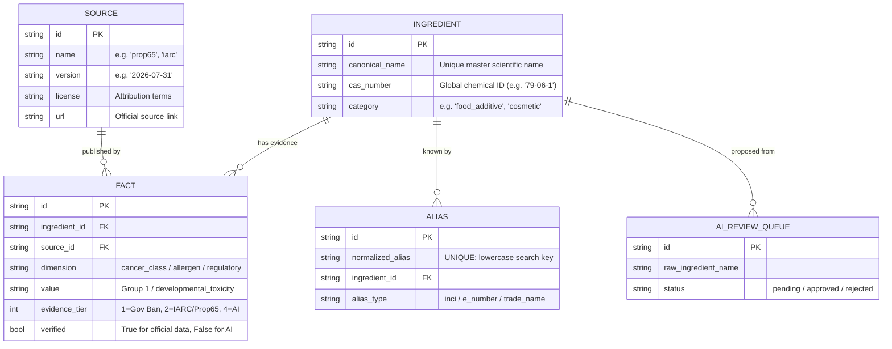

# Phase 1: Data Foundation Documentation

> **Goal:** Build the persistent, relational-style data layer in MongoDB Atlas for canonical ingredients, packaging aliases, toxicological/regulatory facts, data sources, and unverified AI fallback proposals.

---

## 1. The Core Mental Model: Why 5 Collections Instead of 1?

When building an ingredient safety engine, a common mistake is storing everything in a single, unstructured JSON document:

```json
// ❌ The Naive Approach
{
  "name": "Acrylamide",
  "verdict": "toxic",
  "other_names": ["2-propenamide", "acrylic acid amide"]
}
```

### Why that fails in real-world production:
1. **Packaging is messy:** A single chemical can have dozens of names in the wild:
   - Cosmetic INCI names (`CI 77891`)
   - Food E-numbers (`E171`)
   - Trade names (`Titania`)
   - Scientific names (`Titanium Dioxide`)
   Searching inside nested arrays across documents requires full-collection scans ($O(N)$), which is slow and memory-intensive.
2. **Science consists of facts, not subjective verdicts:** Does Acrylamide cause cancer? According to the WHO (IARC Group 2A) and California Prop 65, yes. But is it legally banned in food? No, it has benchmark guidelines. **We must store objective facts, and compute risk dynamically via a rule engine.**
3. **Legal Attribution:** When displaying safety flags to consumers, you must legally cite **who** issued the classification (California EPA OEHHA? WHO IARC? EU Commission?) and when that dataset was retrieved.

To solve this, we separate concerns into **5 distinct collections**:



---

## 2. Models & Helpers Breakdown

All models live in `app/models/` and combine:
1. **Pydantic Schemas (`BaseModel`):** Provide type validation, field documentation, and Swagger/OpenAPI support (equivalent to Dart classes with `@JsonSerializable()` or Freezed).
2. **MongoDB Helpers (`*_helper`):** Convert MongoDB BSON documents (`_id: ObjectId(...)`) into clean, JSON-serializable dictionaries.

### 2.1 `app/models/source.py`
Stores metadata about imported regulatory and scientific datasets.
* **Fields:** `name`, `version`, `license`, `url`, `attribution`, `retrieved_at`.
* **Purpose:** Ensures compliance with open-data licenses and tracks whether database facts are up-to-date.

### 2.2 `app/models/ingredient.py`
The master canonical identity of each substance.
* **Fields:** `canonical_name`, `cas_number`, `category`, `description`, `created_at`.
* **Purpose:** Serves as the single master record to which all aliases and facts attach.

### 2.3 `app/models/alias.py`
Maps label text variations, E-numbers, and trade names directly to canonical ingredients.
* **Fields:** `normalized_alias`, `ingredient_id`, `alias_type`, `created_at`.
* **Key Design Choice:** Has a **unique index** on `normalized_alias`. This guarantees that an alias like `"e250"` maps unambiguously to one master ingredient ($O(1)$ fast lookup).

### 2.4 `app/models/fact.py`
Stores objective scientific and regulatory claims without computing premature verdicts.
* **Fields:**
  * `ingredient_id`: Foreign key pointing to `Ingredient`.
  * `source_id`: Foreign key pointing to `Source`.
  * `dimension`: The risk category (`cancer_class`, `developmental`, `reproductive`, `regulatory`, `allergen`, `irritation`).
  * `value`: The objective classification (`Group 1`, `listed_carcinogen`).
  * `severity`: `low` | `medium` | `high` | `critical`.
  * `evidence_tier`:
    * **Tier 1:** Government legal bans & restrictions (Highest trust).
    * **Tier 2:** IARC & Prop 65 classifications.
    * **Tier 3:** Expert advisory panels (CIR, SCCS).
    * **Tier 4:** AI-generated unverified proposals (Lowest trust).
  * `verified`: `True` for official dataset records; `False` for AI proposals.

### 2.5 `app/models/ai_review.py`
A queue for human verification of unrecognised ingredients processed by Gemini.
* **Fields:** `raw_ingredient_name`, `suggested_canonical_name`, `category`, `proposed_facts`, `status`, `notes`.
* **Purpose:** Ensures unverified AI proposals remain in a sandbox until explicitly approved by an administrator.

---

## 3. Database Indexes (`app/db/indexes.py`)

### What is an Index? (The Book Analogy)
Without an index, finding an ingredient among 50,000 documents requires a **Full Collection Scan** ($O(N)$), examining every document sequentially. An index functions like the alphabetical index at the back of a book, enabling direct $O(1)$ or $O(\log N)$ navigation.

### Indexes Enforced:
1. **`sources`:** Unique compound index on `(name, version)` — prevents accidental re-importation of identical dataset versions.
2. **`ingredients`:** Unique index on `canonical_name`; sparse index on `cas_number`.
   * *Sparse Index:* Ingredients without a chemical CAS number (e.g. natural juices) are omitted from the index, conserving RAM.
3. **`aliases`:** Unique index on `normalized_alias` — guarantees one-to-one alias resolution.
4. **`facts`:** Compound index on `(ingredient_id, dimension)` and unique compound index on `(ingredient_id, source_id, dimension)` to eliminate duplicate findings.
5. **`ai_review_queue`:** Index on `status` (`pending`, `approved`, `rejected`).

---

## 4. Seeding Engine (`scripts/common.py`, `scripts/seed_prop65.py`, `scripts/seed_iarc.py`)

### 4.1 Upsert Semantics (`Update + Insert`)
To ensure that re-running seeding scripts does not create duplicate entries:
* If the record exists: Update any newly available fields.
* If the record does not exist: Insert it as a new document.

### 4.2 Text Normalization (`normalize_name`)
Cleans real-world source data by:
* Converting to lowercase.
* Stripping editorial bracket notes (e.g. `Actinomycin D [Basis changed...]` $\rightarrow$ `actinomycin d`).
* Removing obsolete delisting remarks.
* Normalizing multiple spaces and punctuation.

### 4.3 Prop 65 Seeder (`scripts/seed_prop65.py`)
* Reads `data/raw/p65chemicalslist.csv`.
* Skips delisted chemicals.
* Extracts parenthetical synonyms (e.g. `4-Aminobiphenyl (4-aminodiphenyl)` $\rightarrow$ alias `4-aminodiphenyl`).
* Splits toxicity types (`cancer` $\rightarrow$ cancer_class, `developmental` $\rightarrow$ developmental, `male/female` $\rightarrow$ reproductive).

### 4.4 IARC Monographs Seeder (`scripts/seed_iarc.py`)
* Reads `data/raw/List of Classifications...csv`.
* Maps WHO classifications to severity levels:
  * **Group 1** (Carcinogenic to humans) $\rightarrow$ `critical`
  * **Group 2A** (Probably carcinogenic) $\rightarrow$ `high`
  * **Group 2B** (Possibly carcinogenic) $\rightarrow$ `medium`
  * **Group 3** (Not classifiable) $\rightarrow$ `low`

---

## 5. Execution Reference

Run these commands from `scanrix-backend` in your terminal:

```bash
# 1. Create database indexes
python -m app.db.indexes

# 2. Seed California Proposition 65
python -m scripts.seed_prop65

# 3. Seed WHO IARC Monographs
python -m scripts.seed_iarc
```
