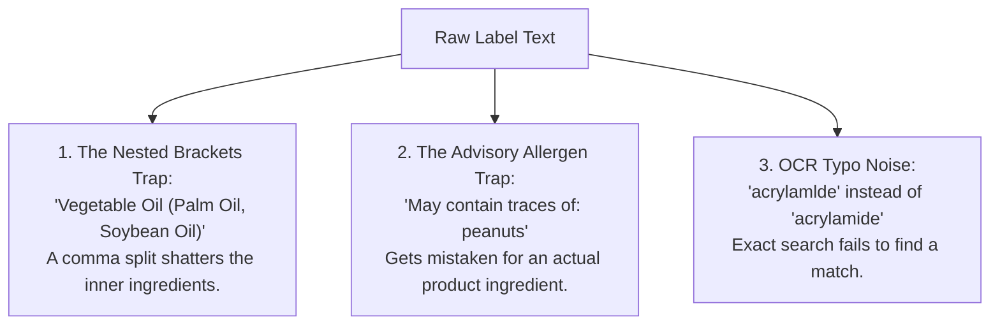
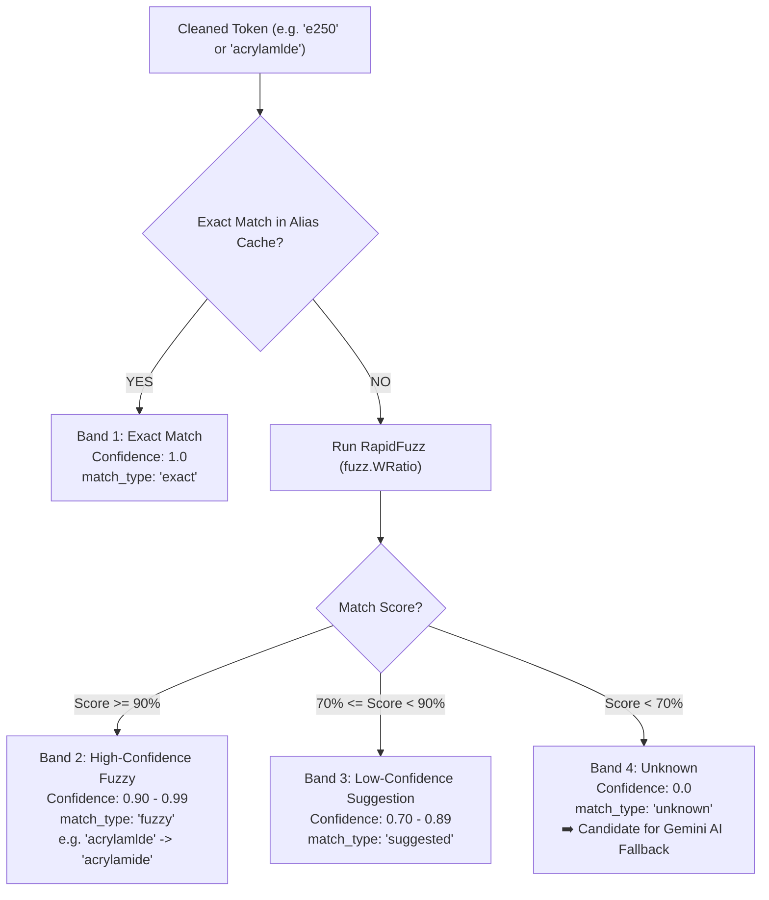

# Phase 2: Parsing & Matching Documentation

> **Goal:** Transform unstructured, noisy packaging text and OCR strings into clean, structured ingredient entities, and resolve them against canonical database records using exact matching and typo-tolerant fuzzy matching.

---

## 1. The Packaging Problem

When a consumer scans a barcode or captures an ingredient panel with a mobile camera, the application receives a raw, unstructured text block:

> *"Ingredients: Cocoa Butter (15%), Vegetable Oil (Palm Oil, Soybean Oil), Sugar, Preservative (E250). May contain traces of: peanuts, tree nuts."*

A naive solution such as `text.split(",")` fails on real-world labels for three major reasons:



---

## 2. The Ingredient Parser (`app/services/ingredient_parser.py`)

The parser breaks raw text into structured `ParsedIngredient` tokens while isolating allergen warnings:

```python
class ParsedIngredient(BaseModel):
    raw_text: str          # Original string, e.g. 'Vegetable Oil (Palm Oil 15%)'
    clean_name: str        # Normalized for lookup: 'vegetable oil'
    sub_ingredients: list  # Extracted bracketed items: ['palm oil']
    percentage: float      # Declared amount: 15.0
```

### 2.1 Key Parser Algorithms

#### A. Bracket-Aware Splitting (`split_top_level`)
Instead of splitting on every comma, the parser maintains an internal `depth` counter tracking parentheses `(`, `[`, `{`:
* When `depth == 0`: Commas or semicolons indicate boundaries between distinct ingredients.
* When `depth > 0`: Commas occur inside nested parenthetical sub-ingredients and are preserved.

```python
# 'Enriched Flour (Wheat, Salt), Cocoa'
# -> ['Enriched Flour (Wheat, Salt)', 'Cocoa']
```

#### B. Precautionary Allergen Extraction (`extract_advisories`)
Extracts trailing advisory phrases matching patterns such as:
* `May contain traces of...`
* `Allergen advice: contains...`
* `Packed in a plant that handles...`

These are placed into a dedicated `allergens_declared` list and removed from the main ingredient list to prevent false ingredient matches.

#### C. Sub-Ingredient Extraction (`extract_sub_ingredients`)
Parenthetical content is inspected:
* E-numbers (`E330`) or percentages (`15%`) are stripped.
* Sub-ingredients (e.g. `Palm Oil, Soybean Oil`) are parsed into child tokens so safety checks can evaluate both the parent ingredient and all sub-components.

#### D. Percentage Extraction (`extract_percentage`)
Detects expressions like `(15%)` or `2.5%`, extracts the numerical value into `percentage: float`, and removes the percentage substring from the ingredient name.

---

## 3. The Ingredient Matcher (`app/services/ingredient_matcher.py`)

Once the parser produces clean tokens, the Matcher evaluates each token using **Three Confidence Bands**:



### 3.1 The In-Memory Alias Cache
To maintain sub-millisecond response times without exhausting MongoDB free-tier network bandwidth:
* The matcher pre-loads an in-memory dictionary:
  ```python
  ALIAS_MAP = {
      "e250": "id_sodium_nitrite",
      "ci 77891": "id_titanium_dioxide",
      "aqua": "id_water",
      ...
  }
  ```
* Lookups occur in memory at $O(1)$ speed ($< 0.1\text{ ms}$).
* 20,000 aliases consume less than 3 MB of RAM, remaining well within Render's 512 MB memory limit.

### 3.2 OCR Typo Resilience with RapidFuzz
Mobile camera OCR frequently misidentifies characters (e.g. an `l` instead of an `i` in `acrylamlde`).
* The matcher calculates string similarity using `rapidfuzz.fuzz.WRatio`.
* Minor typographical errors resolve to verified canonical ingredients with a clear confidence metric, preventing unnecessary AI fallback calls.

---

## 4. Verification & Testing

Both the parser and matcher include self-contained unit test suites that run entirely in memory:

```bash
# Run parser test suite
python tests/test_parser.py

# Run matcher test suite
python tests/test_matcher.py
```

### Expected Output:
```
🧪 Running Ingredient Parser Tests...
✅ test_basic_parsing passed!
✅ test_prefix_removal passed!
✅ test_sub_ingredients_and_brackets passed!
✅ test_percentage_extraction passed!
✅ test_advisory_allergen_extraction passed!
✅ test_ocr_noise passed!
🎉 All parser tests passed successfully!

🧪 Running Ingredient Matcher Tests...
  ✅ Exact match passed ('acrylamide')
  ✅ Alias match passed ('e250' -> Sodium Nitrite, 'ci 77891' -> Titanium Dioxide)
  ✅ Fuzzy typo match passed ('acrylamlde' matched 'acrylamide' with 91.0% confidence)
  ✅ Unknown rejection passed (correctly sent to AI fallback)
🎉 All matcher tests passed successfully!
```
