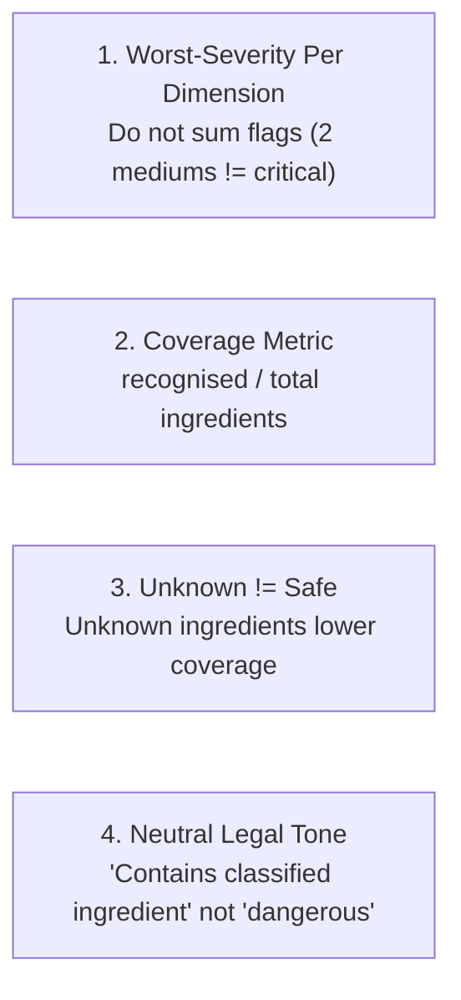

# Phase 3: Rule Engine Documentation

> **Goal:** Transform scientific facts into deterministic, multi-dimensional safety assessments using pure evaluation logic without database or network dependencies.

---

## 1. The Core Philosophy: "Rules as Data"

In naive implementations, safety checks are written directly as hardcoded Python `if/else` statements:

```python
# ❌ The Anti-Pattern: Hardcoded Logic
if "group 1" in fact:
    return "danger"
```

### Why "Rules as Data" is Superior:
1. **Versionable (`ruleset_v1.json`, `ruleset_v2.json`):** When scientific consensus or government regulations evolve, you do not modify Python source code. You publish a new ruleset version.
2. **Auditability:** You can trace every single flag to a specific rule ID and scientific evidence tier.
3. **Pure Function:** The `evaluate()` function takes `(data, ruleset)` and returns results deterministically. The same input **always** yields the exact same output.

---

## 2. Ruleset Structure (`app/rules/ruleset_v1.json`)

The ruleset defines:
* **`severity_ranks`:** Numerical weights for sorting severity:
  $$\text{none } (0) < \text{low } (1) < \text{medium } (2) < \text{high } (3) < \text{critical } (4)$$
* **`dimensions`:** Distinct risk areas (`cancer_class`, `developmental`, `reproductive`, `regulatory`, `allergen`, `irritation`).
* **`rules`:** Exact condition mappings:
  * `iarc_group_1` $\rightarrow$ Critical
  * `iarc_group_2a` $\rightarrow$ High
  * `prop65_cancer` $\rightarrow$ High
  * `prop65_developmental` $\rightarrow$ High
  * `prop65_reproductive` $\rightarrow$ High
  * `regulatory_prohibited` $\rightarrow$ Critical

---

## 3. The 4 Golden Principles of the Rule Engine



### Principle 1: Worst-Severity Per Dimension (Non-Additive)
Hazards are not points on a leaderboard. If a snack contains 3 medium allergens (e.g. wheat, soy, milk), the allergen dimension is **`medium`**, not "critical". The engine selects the **maximum severity observed** within each dimension.

### Principle 2: Coverage Metric
Instead of pretending every product is fully understood, the engine calculates a transparent coverage score:
$$\text{Coverage} = \frac{\text{Recognised Ingredients}}{\text{Total Ingredients}}$$
* Example: 8 recognised ingredients out of 10 $\rightarrow$ **Coverage: 80% (0.80)**.

### Principle 3: Unknown Ingredients are Never Labeled "Safe"
If an ingredient is unknown, its status is **`unassessed`**. It lowers the coverage metric, alerting the user that 100% certainty is not possible.

### Principle 4: Objective, Neutral Language
To prevent false alarms and legal liability, the engine uses strictly factual terminology:
* ❌ Avoid: *"This product is toxic and dangerous to consume."*
* ✅ Use: *"Contains an ingredient classified by WHO IARC as Group 1 (Carcinogenic to humans)."*

---

## 4. Output Data Structure (`EvaluationResult`)

The engine returns structured findings ready for the API and Flutter UI:

```python
class EvaluationResult(BaseModel):
    ruleset_version: str             # e.g. '1.0.0'
    coverage: float                  # e.g. 0.85 (85%)
    recognised_count: int            # e.g. 17
    total_count: int                 # e.g. 20
    overall_severity: str            # 'none' | 'low' | 'medium' | 'high' | 'critical'
    dimensions: dict                 # Breakdown by risk dimension
    findings: list                   # Per-ingredient findings with evidence tiers
    disclaimer: str                  # Informational medical disclaimer
```

---

## 5. Verification & Testing

Run the test suite in your terminal to verify determinism, coverage, and severity ranking:

```bash
python tests/test_rule_engine.py
```

### Expected Output:
```
🧪 Running Rule Engine Tests...
✅ test_pure_function_determinism passed!
✅ test_coverage_and_unknown_handling passed!
✅ test_worst_severity_ranking passed!
✅ test_non_additive_severity passed!
🎉 All rule engine tests passed successfully!
```
