# Phase 4: Scan Flow Integration Documentation

> **Goal:** Connect the Database-First Safety Engine directly into the live FastAPI scan routes (`/api/v1/scan` and `/api/v1/scan/analyze-text`), delivering instant (< 50ms) deterministic evaluations while preserving 100% backward compatibility with existing Flutter mobile apps.

---

## 1. The Architecture Shift: Before vs. After

```mermaid
flowchart TD
    subgraph OldFlow["Old Flow: AI-First (Slow & Expensive)"]
        O1["User scans barcode"] --> O2["Fetch Open Food Facts"]
        O2 --> O3["Save with verdict = 'analyzing'"]
        O3 --> O4["Mobile app polls server"]
        O4 --> O5["Call Gemini LLM in background (10-15s wait)"]
        O5 --> O6["Save AI verdict into product"]
    end

    subgraph NewFlow["New Flow: Database-First (Instant & Deterministic)"]
        N1["User scans barcode"] --> N2["Fetch Open Food Facts / Cache"]
        N2 --> N3["Parse text (IngredientParser)"]
        N3 --> N4["Match aliases in memory (< 1ms)"]
        N4 --> N5["Single batch query for verified facts (~15ms)"]
        N5 --> N6["Pure RuleEngine evaluation (< 1ms)"]
        N6 --> N7["Immediate Response (< 50ms total)"]
        N7 --> N8{"Any unknown ingredients?"}
        N8 -- "NO" --> N9["✨ 0 AI calls, 0 latency, 0 cost!"]
        N8 -- "YES" --> N10["Queue unknowns for background AI fallback"]
    end
```



---

## 2. The Orchestration Service (`app/services/ingredient_db_service.py`)

This service acts as the central conductor connecting all components:

### Step 1: In-Memory Cache Verification
Ensures all aliases are loaded in memory via `ingredient_matcher.ensure_matcher_ready()`.

### Step 2: Bracket-Aware Parsing
Calls `ingredient_parser.parse(raw_text)` to extract main ingredients, sub-ingredients (e.g. `palm oil` inside `vegetable oil`), and advisory allergen warnings (`May contain...`).

### Step 3: Fast Matching
Resolves each ingredient name against the database. Collects all matched `ingredient_id`s.

### Step 4: Batched Fact Retrieval
Instead of issuing 20 separate database queries for 20 ingredients, it issues **a single batch query**:
```python
cursor = db.facts.find({"ingredient_id": {"$in": list(matched_ids)}}, {"_id": 0})
```

### Step 5: Pure Rule Evaluation
Passes the assembled facts into `rule_engine.evaluate()` to produce `EvaluationResult`.

---

## 3. Backward Compatibility Strategy

Older versions of the Flutter app expect three specific fields:
* `verdict`: `"safe"` | `"caution"` | `"avoid"`
* `overall_score`: Integer from `0` to `100`
* `summary`: Human-readable explanation text

The `ingredient_db_service.calculate_legacy_verdict_and_score()` function translates the multi-dimension evaluation into these legacy fields:

| Overall Severity | Coverage | Legacy Verdict | Legacy Score |
|---|---|---|---|
| `critical` | Any | `avoid` | `15` |
| `high` | Any | `avoid` | `35` |
| `medium` | Any | `caution` | `60` |
| `low` / `none` | $\ge 70\%$ | `safe` | `90` |
| `low` / `none` | $< 70\%$ | `caution` | `70` *(flagged due to low coverage)* |

### Response Schema (`ScanResponse`):
```json
{
  "product": {
    "name": "Potato Chips",
    "verdict": "safe",
    "overall_score": 90,
    "summary": "No classified toxicological hazards identified..."
  },
  "safety_engine": {
    "ruleset_version": "1.0.0",
    "coverage": 0.85,
    "recognised_count": 17,
    "total_count": 20,
    "overall_severity": "none",
    "dimensions": { ... },
    "findings": [ ... ],
    "disclaimer": "This analysis is for informational purposes only..."
  }
}
```

* **Older Flutter screens** read `product.verdict` and `product.overall_score`.
* **Newer Flutter screens** read the comprehensive `safety_engine` payload.

---

## 4. Endpoints Updated in [`app/api/v1/endpoints/scan.py`](file:///Users/jazz/Documents/projects/SCANRIX/scanrix-backend/app/api/v1/endpoints/scan.py)

### 1. `POST /api/v1/scan/` (Barcode Scan)
* If product is in DB: re-evaluates ingredients against the latest ruleset and returns verified safety data.
* If product is not in DB: fetches from Open Food Facts / Open Beauty Facts, runs immediate safety evaluation, saves product, and only invokes Gemini if unrecognised ingredients remain.

### 2. `POST /api/v1/scan/analyze-text` (Direct OCR Text Analysis)
* Directly parses packaging OCR text.
* Returns both legacy score/verdict and the full multi-dimension `safety_engine` breakdown.
