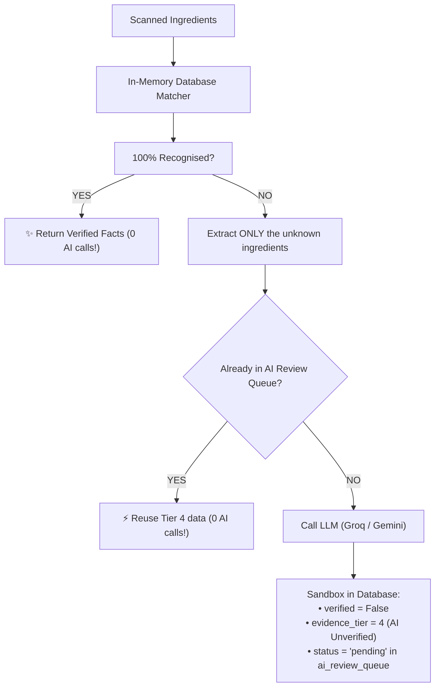

# Phase 5: AI Fallback & Review Queue Documentation

> **Goal:** Constrain AI strictly to unrecognised ingredients, sandbox all AI outputs as unverified Tier 4 evidence, cache unknown ingredients so LLMs are never queried twice, and provide a human-in-the-loop review workflow.

---

## 1. The Core Philosophy: "AI as a Fallback, Never the Judge"

In naive AI scanner apps, whenever a product is scanned, the entire ingredient list is sent to an LLM:

```
❌ The Dangerous Pattern:
Scanned Ingredients -> Sent to LLM -> LLM Hallucinates -> Shown to User as "Truth"
```

### Why this is dangerous:
1. **Non-deterministic:** The same shampoo scanned today might get a different answer tomorrow.
2. **Hallucinations:** LLMs often mistake benign plant extracts for hazardous toxins, or miss real carcinogens.
3. **Expensive & Slow:** Scanning 20 ingredients burns API tokens and takes 10+ seconds.

### The Scanrix Solution (Sandboxed Fallback):


---

## 2. The AI Fallback Service (`app/services/ai_fallback_service.py`)

### 2.1 Structured Classification Prompt
Instead of asking for free-form text, the service constrains the LLM to a strict JSON structure:
```json
{
  "suggested_canonical_name": "clean chemical name",
  "category": "preservative | food_additive | surfactant",
  "proposed_facts": [
    {
      "dimension": "allergen | irritation | cancer_class",
      "value": "objective finding description",
      "severity": "low | medium | high",
      "reason": "1-sentence scientific rationale"
    }
  ]
}
```

### 2.2 Sandboxed Ingestion
When the LLM responds:
1. **Source Citation:** Links the fact to an automated source entity: `"ai_llm_proposal"` in the `sources` collection.
2. **Low Trust Tag:** Saves the finding with:
   * `verified: False`
   * `evidence_tier: 4` *(The lowest trust tier)*
3. **Queue Ticket:** Inserts a document into `ai_review_queue`:
   ```json
   {
     "raw_ingredient_name": "polyquaternium-7",
     "suggested_canonical_name": "polyquaternium-7",
     "status": "pending",
     "proposed_facts": [ ... ],
     "created_at": "..."
   }
   ```
4. **Permanent Cache:** Creates an alias pointing from the raw name to this new unverified entity. **If 10,000 users scan this ingredient tomorrow, zero additional AI calls are made.**

---

## 3. Human-in-the-Loop Admin Review API (`app/api/v1/endpoints/admin_review.py`)

All review actions are exposed under the `/api/v1/admin` route prefix:

### 3.1 List Review Queue
* **Endpoint:** `GET /api/v1/admin/queue?status=pending`
* **Response:**
  ```json
  {
    "status": "pending",
    "count": 1,
    "items": [
      {
        "id": "6708ab1c98...",
        "raw_ingredient_name": "polyquaternium-7",
        "suggested_canonical_name": "polyquaternium-7",
        "category": "cosmetic",
        "proposed_facts": [ ... ],
        "status": "pending"
      }
    ]
  }
  ```

### 3.2 Approve Proposal
* **Endpoint:** `POST /api/v1/admin/queue/{review_id}/approve`
* **Body:** `{"notes": "Verified against CIR cosmetic safety panel report."}`
* **What happens behind the scenes:**
  1. Queue ticket status changes to `"approved"`.
  2. Associated facts are promoted:
     * `evidence_tier`: Promoted from `4` (AI Unverified) $\rightarrow$ `3` (Human Reviewed).
     * `verified`: Set to `True`.

### 3.3 Reject Proposal
* **Endpoint:** `POST /api/v1/admin/queue/{review_id}/reject`
* **Body:** `{"notes": "Hallucination. Benign salt, no toxicity."}`
* **What happens behind the scenes:**
  1. Queue ticket status changes to `"rejected"`.
  2. All Tier 4 unverified facts for this item are **deleted from the database**, guaranteeing that future scans will never be falsely flagged!

---

## Update 2026-10-12: fallback is off by default

- New setting `AI_FALLBACK_ENABLED` (default `false`, see `app/core/config.py` and `.env.example`). When off, `/scan` leaves unknown ingredients as "not assessed" and schedules no background task.
- `run_ai_fallback_background` no longer re-analyses the unknowns and no longer calls `update_product_analysis`. Previously it overwrote the product's score, verdict and ingredient list with an AI result for only the unknown ingredients. The engine now owns those fields.
- Open before enabling AI: a failed AI call should save nothing (today it saves an empty ingredient that later counts as recognised), and Tier 4 facts need a rule so they cannot set the overall verdict alone.
