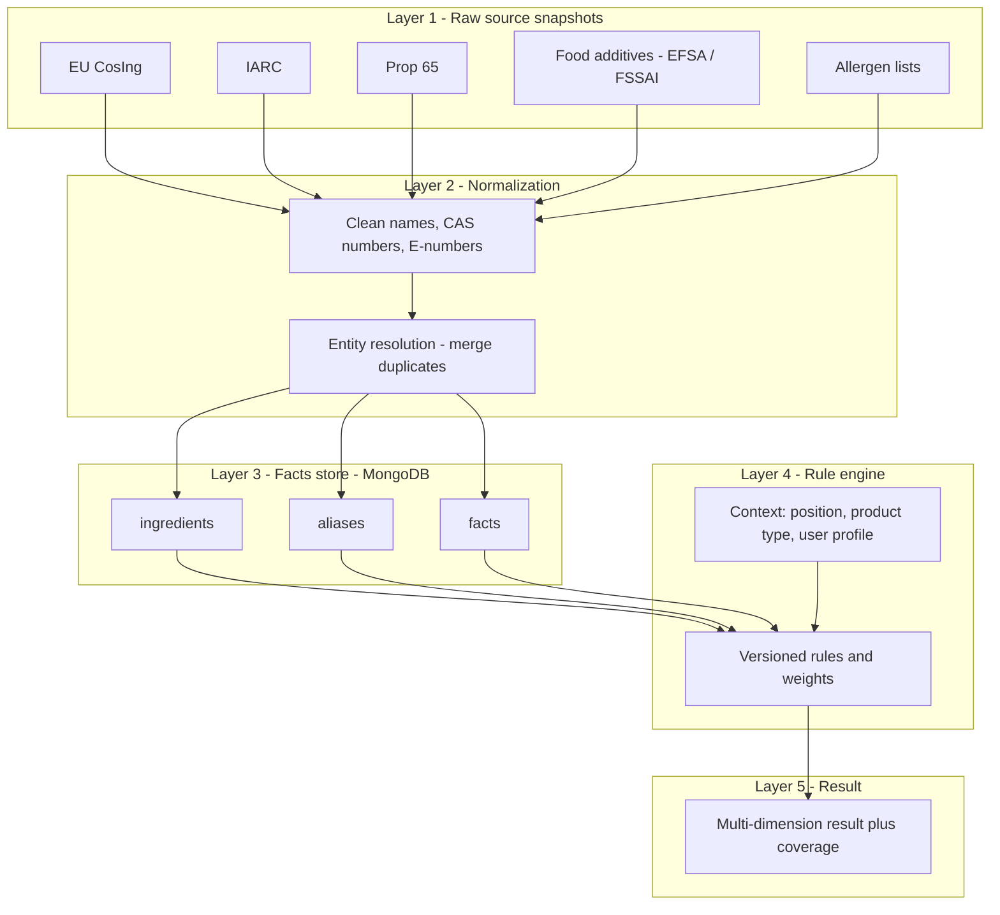
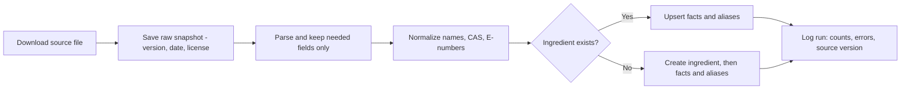
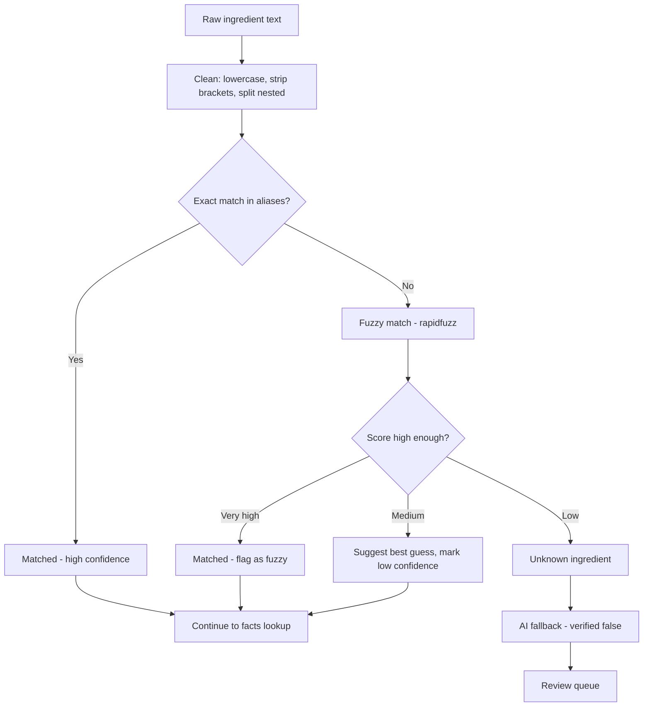
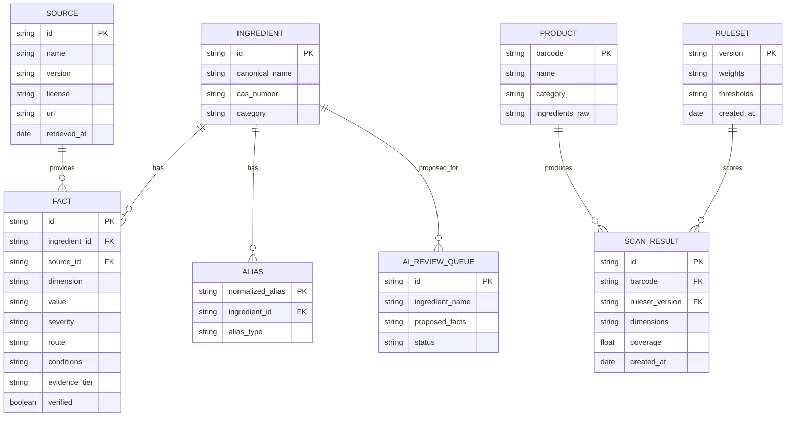
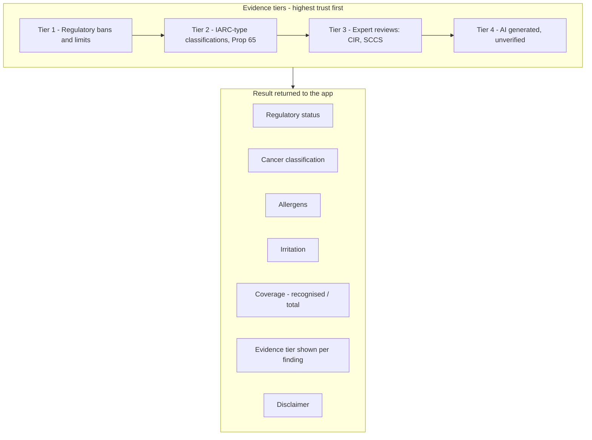
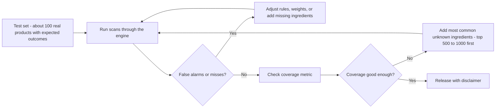

# Scanrix - Ingredient Safety Architecture

Database-first ingredient knowledge base. AI is used only as a fallback for unknown ingredients, and its output is stored as unverified.

How to use in Notion: type `/code`, set language to **Mermaid**, paste one diagram per block. Or import this file via Notion's Import > Markdown.

---

## 1. Layered architecture



---

## 2. Seeding pipeline (run manually or on a schedule, not at app startup)



---

## 3. Scan flow (runtime)

```mermaid
sequenceDiagram
    participant App as Flutter app
    participant API as FastAPI
    participant DB as MongoDB
    participant OFF as Open Food Facts API
    participant AI as Gemini

    App->>API: Send barcode or OCR text
    API->>DB: Product cached?
    alt Not cached
        API->>OFF: Fetch product by barcode
        OFF-->>API: Ingredient text
        API->>DB: Cache product
    end
    API->>API: Parse and normalize ingredients
    API->>DB: Lookup aliases, then facts
    DB-->>API: Matches and facts
    opt Unknown ingredients remain
        API->>AI: Ask about unknown ones only
        AI-->>API: Draft info
        API->>DB: Save as verified false and add to review queue
    end
    API->>API: Rule engine builds result and coverage
    API-->>App: Dimensions, evidence tiers, coverage, disclaimer
```

---

## 4. Ingredient matching



---

## 5. Data model (entities)



Notes:
- `ALIAS.normalized_alias` should have a **unique index**.
- `FACT.dimension` holds values like `regulatory`, `cancer_class`, `allergen`, `irritation`.
- `FACT.evidence_tier` is 1 to 4 (see diagram 6).

---

## 6. Evidence trust tiers and result dimensions



---

## 7. Quality loop



---

## Key principles

1. Layer the system: raw snapshots, normalization, facts, rule engine, result. Keep each layer separate and versioned.
2. Separate alias collection with a unique index; use rapidfuzz for typos and suggest low-confidence matches instead of accepting them silently.
3. Return several dimensions (regulatory, cancer classification, allergens, irritation, coverage), not one verdict.
4. Rank evidence by trust and show the tier in the UI.
5. Treat AI output as unverified: store with `verified: false`, cache, queue for review.
6. Start with the top 500 to 1,000 common ingredients and track a coverage metric.
7. Keep a test set of about 100 real products with expected outcomes.
8. Show a clear disclaimer: informational, not medical advice.